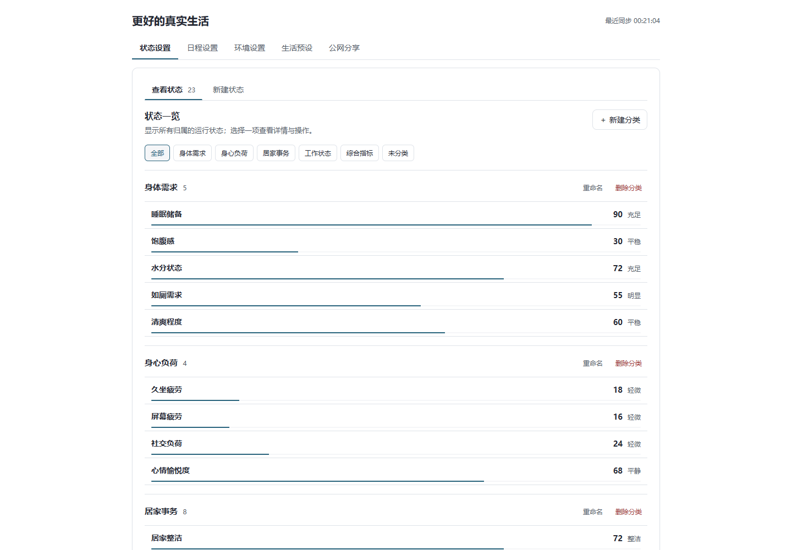
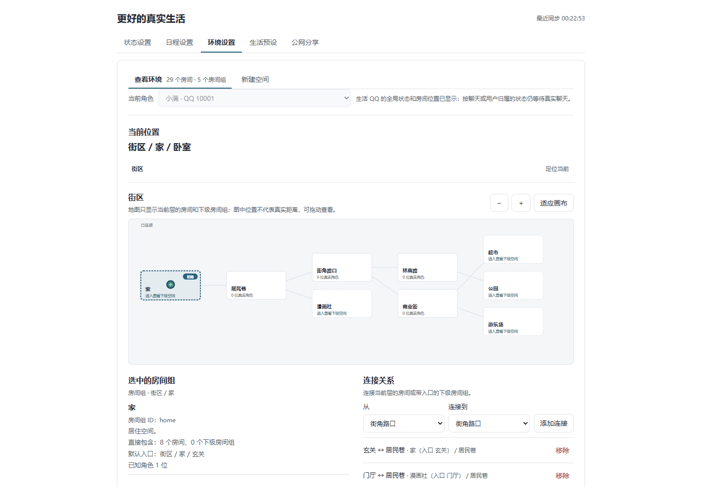

# Better Real Me · 更好的真实生活

**1.0.0 · AstrBot 插件 · QQ · 作者 Xing**

让机器人拥有对话之外也在继续的虚拟生活。

Better Real Me 为 QQ 角色提供随时间变化的状态、每天的日程和可以移动的街区。即使无人聊天，角色也能按自身需要吃饭、洗澡、休息、工作和更换房间；再次聊天时，模型可以感知它当前的状态、活动与位置。

[下载 1.0.0 插件安装包](https://github.com/Nortea575/astrbot_plugin_better_real_me/releases/download/v1.0.0/astrbot_plugin_better_real_me-1.0.0.zip) · [配套公网服务](https://github.com/Nortea575/better_real_me_share) · [版本说明](https://github.com/Nortea575/astrbot_plugin_better_real_me/releases/tag/v1.0.0)

[快速开始](#快速开始) · [街区生活](#街区生活) · [聊天指令](#聊天指令) · [公网分享](#公网分享) · [LivingMemory](#livingmemory)

## 效果展示

以下截图使用虚构角色与演示数据。

**按分类查看状态与综合指标，点击状态条展开详情和操作。**



**用房间组组织街区，查看连接关系与角色所在位置。**



## 主要功能

- **持续状态**：创建数值、是非、选项或文字状态，组合时间变化、阶段表现、交互和事件积木。
- **综合指标（状态组）**：把多个基础数值状态按权重组合，例如由睡眠、饮食等共同决定精力。
- **日程安排**：设置时区、每周日期和跨午夜时段，让日程影响状态变化。
- **街区环境**：嵌套房间组、连接不同地点，以头像标示角色位置，并提供模型查看和移动的工具。
- **自主生活**：启用街区生活预设，按需求、活动时段和房间连接推进日常，也可调整动作的条件与步骤。
- **可选集成**：通过 LivingMemory 保存生活事件，或把状态、日程和位置分享为公网只读页面。

## 快速开始

### 环境要求

- AstrBot **4.29.3 或更新版本**。
- 已连接的 QQ 机器人，使用 **aiocqhttp / OneBot v11** 适配器。
- 如需在聊天中让模型查看环境、移动或执行交互，需使用支持工具调用的模型。

基础自主生活按规则运行，无需另装记忆插件或公网服务。

### 安装插件

1. 打开 AstrBot WebUI 的 **插件 → 安装插件**，选择 **从链接安装**，填写：

   ```text
   https://github.com/Nortea575/astrbot_plugin_better_real_me
   ```

   也可以选择 **从文件安装**，上传 [1.0.0 插件 ZIP 安装包](https://github.com/Nortea575/astrbot_plugin_better_real_me/releases/download/v1.0.0/astrbot_plugin_better_real_me-1.0.0.zip)。
2. 确认插件加载成功，打开插件的可视化视图 **更好的真实生活**。
3. 保持 QQ 连接在线。页面会自动识别登录的真实 QQ 账号，无需先发送聊天消息。
4. 进入 **生活预设**，找到对应 QQ，点击 **启用街区生活**。
5. 在 **状态设置、日程设置、环境设置** 中查看已添加的内容，按自己的角色设定调整。

安装入口的具体操作可参考 [AstrBot 插件安装说明](https://docs.astrbot.app/use/plugin.html)。

首次安装不会自动启用生活预设。你可以先预览预设内容，也可以从空白开始自行搭建状态、日程与环境。

## 街区生活

内置的 **街区生活** 预设把家与周边地点组织在同一个街区中，包括公园、超市、游乐场和漫画社。角色根据房间之间的连接移动，再执行对应活动。

预设同时提供状态、综合指标、生活时段和动作，并自带分类：身体需求、身心负荷、居家事务、工作状态等内容可以分别查看，无需从一长列未分类条目开始配置。

角色可以进食、饮水、洗漱、洗澡、睡眠、做家务、工作、休闲和购物补给。活动具有条件、持续时间和执行步骤，会改变状态与位置。生活时段表示适合安排某项活动的时间范围，实际是否执行还取决于当时的需求和条件。

在 **生活预设** 中可以查看当前活动、所在房间和近期事件，也可以编辑动作的优先级、冷却时间、可执行时段、条件与步骤。点击 **暂停自动行为** 会暂停当前活动并停止后续安排，保留已有设置和记录；重新启用后会从剩余进度继续。

### 身份与状态归属

街区生活以机器人登录的真实 QQ 账号为身份。同一个 QQ 在不同群聊、私聊和人格下共享同一套生活进度，选择生活人格不会额外创建一份生活。自行创建的状态则按当前人格及所选归属分别保存。

自行创建状态时，可按需要选择归属：

| 归属 | 适合记录的内容 |
| --- | --- |
| 角色整体 | 当前人格下，跨会话共享的身体状态、物品或总体心情 |
| 当前会话 | 当前人格在某个群聊或私聊中的独立状态 |
| 与用户的关系 | 当前人格与某位用户之间的状态，跨会话共享 |

状态一览会展示已有运行状态；会话状态和用户关系状态会标明归属。

### 模型如何参与

聊天时，插件向模型提供当前状态、日程和位置；模型还可以通过工具读取详情、查看出口、移动到可达房间、执行已配置的交互或报告事件。工具是否被调用取决于模型和 AstrBot 的工具设置。

模型辅助与记忆同步默认关闭。后台生活默认由规则选择下一步；需要模型参与选择时，在对应 QQ 的设置中选择模型服务商，勾选 **由模型辅助选择下一步**，然后保存账号设置。该选项会调用所选模型服务，产生相应的用量；调用失败时会回到规则选择。

**插件不会因为角色吃饭、洗澡或换房间而主动发送 QQ 消息。** AstrBot 需要保持运行，后台生活才能持续推进。

## 聊天指令

以下以 `%A` 为 AstrBot 的唤醒词示例，请替换为自己的配置。

| 指令 | 用途 |
| --- | --- |
| `%A查询 状态` | 查看当前会话可见的状态与综合指标 |
| `%A查询 日程` | 查看固定日程与生活活动安排 |
| `%A查询 地点` | 查看当前位置与相邻出口 |
| `%A帮助` | 查看指令帮助 |

这些查询直接读取插件数据，无需模型生成回答。

## LivingMemory

LivingMemory 是可选的记忆集成。安装并启用兼容的 LivingMemory 后，在对应 QQ 的设置中勾选 **同步生活记忆**，保存即可。

启用后，插件把生活事件写入该账号的记忆范围；同时启用模型辅助时，可以检索相关记忆，供下一步活动选择参考。生活记忆按 QQ 账号区分，并结合所选人格使用。

已适配 LivingMemory **2.9.1**。其他版本需兼容其记忆写入、分页查询与检索接口。未安装或尚未就绪时，基础生活仍可运行；已开启同步但暂未写入的事件会保留在待同步队列中。

## 公网分享

公网分享用于把选定 QQ 的 **状态、日程和位置** 展示为一个只读网页，适合让他人通过浏览器查看角色的近况。

两端职责如下：

| 组件 | 负责的工作 |
| --- | --- |
| AstrBot 插件 | 推进生活、保存本地数据，按需提供选定内容 |
| 独立公网服务 | 提供管理员页面、绑定入口和访客页面，保存最近一次展示数据 |

公网服务可与机器人部署在同一台服务器，也可以放在另一台服务器。机器人主动连接公网服务，无需额外暴露 AstrBot 的管理端口。不开启分享时，不影响本地生活功能。

### 部署与绑定

1. 下载 [公网服务安装包](https://github.com/Nortea575/better_real_me_share/releases/download/v1.0.0/better_real_me_share-1.0.0-linux.tar.gz)，在可访问的服务器上安装，并设置域名或 IP 形式的对外访问地址。
2. 通过安装时输出的首次设置链接，设置管理员密码。
3. 在服务管理页取得一次性绑定链接，粘贴到插件的 **公网分享** 面板。
4. 确认 QQ 账号及需要展示的内容，点击 **绑定并开启分享**。仅有一个已识别 QQ 时会自动选中。
5. 把生成的访客链接发给需要查看的人。

绑定链接有效期为 **20 分钟**，仅用于连接插件；供他人查看时应使用访客链接。持有访客链接的人可以阅读当前启用的分享内容。

<details>
<summary>公网服务的独立安装示例</summary>

配套安装包支持带 systemd 的 Linux x86_64 和 ARM64，内置网页与 SQLite，无需安装 Go、Node.js 或独立数据库。

解压安装包后，将示例 IP 替换为实际地址，执行：

```sh
sudo env REAL_ME_PUBLIC_URL="http://203.0.113.10:18766/" sh ./install.sh
```

服务安装到 `/opt/real_me_add`，默认监听 `18766` 端口，数据保存在 `/opt/real_me_add/data`。需要自行确保该端口能够访问。

如需使用不带端口的 HTTPS 域名，可通过现有反向代理提供 HTTPS。反向代理直接运行在同一台主机时，可让服务仅监听本机地址：

```sh
sudo env REAL_ME_PUBLIC_URL="https://share.example.com/" \
  REAL_ME_LISTEN="127.0.0.1:18766" sh ./install.sh
```

再将该域名的反向代理指向 `http://127.0.0.1:18766`。域名解析、证书和反向代理需要另行配置，安装脚本不会自动改动已有网关。

完整部署与 Docker 用法见 [公网服务说明](https://github.com/Nortea575/better_real_me_share#readme)。

</details>

### 刷新与展示范围

访客打开页面或点击刷新时，公网服务才向插件请求一次最新展示数据。页面不会定时轮询，无人访问时不会周期上传状态快照；维持连接仍有少量通信。刷新只读取现有数据，不触发模型规划或推进生活。

机器人暂时离线时，页面会显示最近保存的数据及其时间。自定义角色状态只展示所选生活人格下已产生的共享状态；会话独立和用户关系状态不对外展示。分享内容不包含聊天记录、模型配置或 LivingMemory 记忆正文，访客页面只提供查看功能。

## 数据保存

插件数据由 AstrBot 管理，保存在插件数据目录下的 `states.sqlite3`，遵循 [AstrBot 插件存储约定](https://docs.astrbot.app/dev/star/guides/storage.html)。常规部署中的相对路径为：

```text
data/plugin_data/astrbot_plugin_better_real_me/states.sqlite3
```

升级或迁移前可停止 AstrBot，再备份该插件数据目录。公网服务的数据独立保存在其安装目录的 `data` 文件夹中。

## 反馈

问题与建议可通过 [GitHub Issues](https://github.com/Nortea575/astrbot_plugin_better_real_me/issues) 提交。反馈问题时请说明 AstrBot 版本、相关设置和复现步骤；日志中如包含密码或绑定凭证，请先隐去。

